<p align="center">
  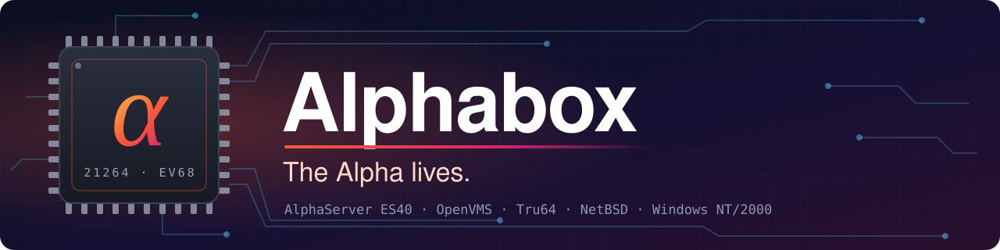
</p>

**Alphabox brings DEC Alpha machines back from the dead.**

It doesn't merely execute Alpha instructions. It recreates the machines
around them: the chipsets, the firmware, the buses and interrupt wiring,
the SCSI adapters, network cards and graphics chips. It does so closely
enough that software written for them a quarter of a century ago runs
without noticing the hardware is gone.

Boot DEC's own SRM console. Start AlphaBIOS from it. Install Windows 2000
and let Microsoft's own ATI driver find an emulated 3D Rage Pro and draw
Direct3D scenes on it. Boot OpenVMS on sixteen EV7 processors in a
machine that once filled a cabinet. And on a modern laptop, the Alpha you are
pretending to own runs faster than the real one ever did.

Alphabox keeps the Alpha as it was, and also shows what it could have
become. It gives the platform things it never had, such as USB 2.0 and
virtio drivers for Alpha Windows and Direct3D with hardware transform and
lighting on a Radeon, and holds each one to the same test as the real
hardware: it has to work under a real Alpha operating system.

[](https://github.com/artur/alphabox/actions/workflows/build-test-and-artifact.yml)
[](LICENSE)

| OpenVMS 8.4 with the CDE desktop | Windows 2000 on two Alpha processors | Direct3D on an emulated ATI 3D Rage Pro |
|---|---|---|
|  | 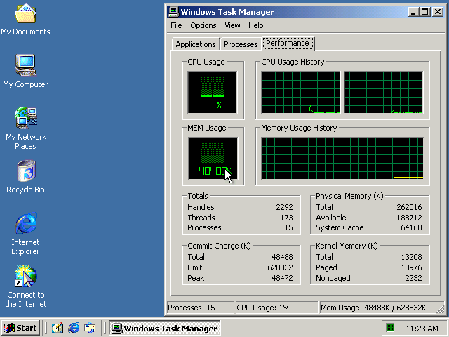 | 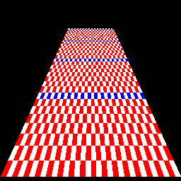 |

## What is this?

Not a generic Alpha emulator. Alphabox emulates specific, real machines
(the AlphaServer ES40 first, and now ten of them, from the DS10 to the
GS1280) well enough that their original firmware, operating systems and
device drivers take them for the real thing:

- OpenVMS 8.4, Tru64 UNIX, Linux, NetBSD, Windows 2000, and the 64-bit Windows
  Microsoft built on the Alpha and never shipped
- the EV68 (21264) on the Tsunami and Titan chipsets, and the EV7 (21364)
  with its on-chip router, up to sixteen of them
- the cards' own VGA BIOSes, and Windows' own drivers for Symbios, QLogic,
  S3, Cirrus, ATI, 3Dlabs and DEC hardware
- Direct3D on graphics chips from 1998, USB 2.0, SMP
- about 3000 MIPS per emulated CPU on an Apple M3 Max, two to three
  times the ES40's own 667 MHz EV68 ([how it is measured](docs/performance.md))

The Alpha outlived its maker; the machines mostly didn't. They are rare
now, their disks are dying, and their software, a whole branch of
computing history, is running out of places to run. Alphabox is one of
those places.

## How real is it?

Alphabox emulates the hardware and lets the original software find it.
Windows 2000 loads its Symbios driver because it finds a Symbios 53C875 in
PCI configuration space. AlphaBIOS runs the graphics card's own x86 VGA
BIOS. OpenVMS discovers an ES47 through the same console callbacks and
management processor it would on HP's hardware.

So the test of correctness is simple: **if the original driver doesn't
work, Alphabox is wrong.** That is the difference from QEMU, which runs
Alpha code well, for Linux, with its own PALcode and firmware in place of
DEC's: Alphabox runs the genuine consoles, and so the operating systems
that depend on them.

## Things that shouldn't work, but do

| OpenVMS 8.4 on an emulated ES47: two EV7s, the CDE login on its Radeon 7500 | dxdiag: ATI's own Direct3D driver, every test passed | Windows 2000 reading a USB disk |
|---|---|---|
| 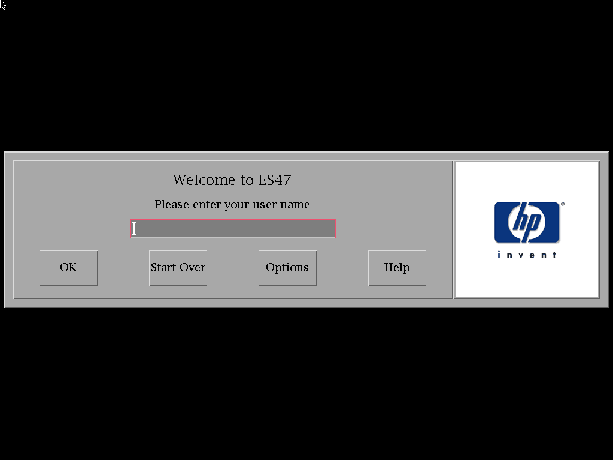 | 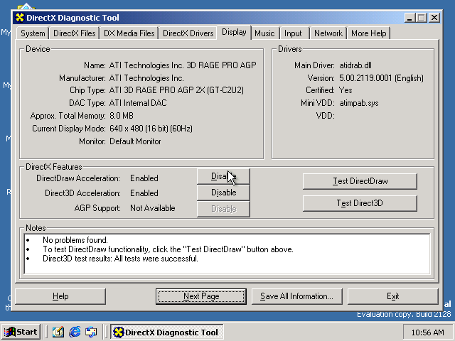 | 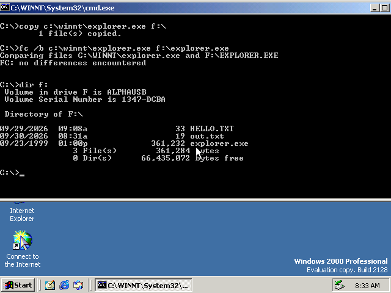 |

| The 64-bit Windows that never shipped: Whistler build 2210 for AXP64 | A 64-bit command prompt on a 21264 | The same Windows on two Alpha processors |
|---|---|---|
| 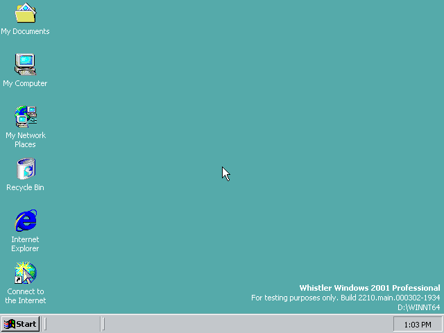 | 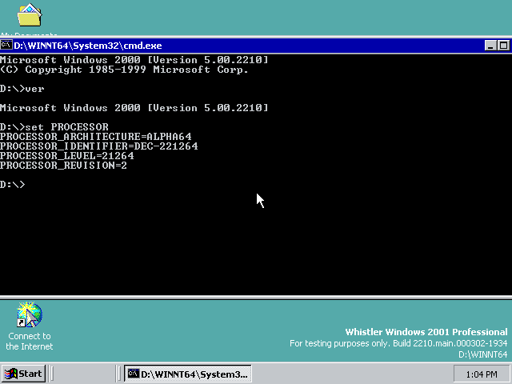 | 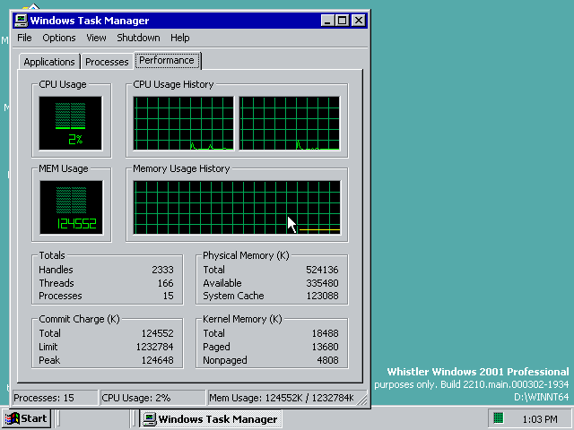 |

- **Direct3D on Windows for Alpha.** The ATI 3D Rage Pro, 3Dlabs Permedia 2
  and S3 ViRGE are emulated well enough that the Direct3D drivers on the
  Windows 2000 CD draw lit, textured scenes, checked pixel by pixel against
  Direct3D's software rasteriser.
- **USB 2.0 on an operating system that never had it.** The driver was
  written with *nada*, a companion C compiler that targets Alpha Windows;
  so were virtio drivers and a Radeon 7500 driver with a Direct3D 7 HAL
  ([guest drivers](docs/guest-drivers.md)).
- **The 64-bit Windows Microsoft never shipped.** Windows "Whistler" build
  2210 for AXP64 installs through AlphaBIOS and runs native 64-bit programs,
  on one processor or two.
- **Sixteen EV7s booting OpenVMS.** The ES47 (two EV7s), ES80 (eight) and
  GS1280 (sixteen) boot OpenVMS 8.4 from an installed disk, through a
  management-processor protocol HP never documented.

## What runs

| Linux 7.0 on the ES40 | The NetBSD 10.2 installer | A Japanese Windows 2000 beta, build 1877 |
|---|---|---|
| 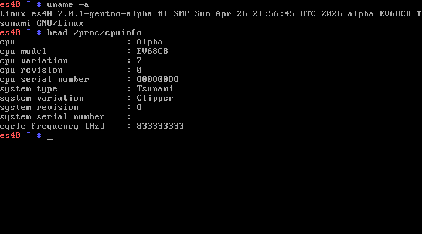 | 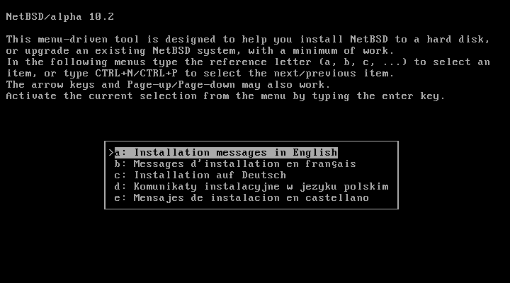 | 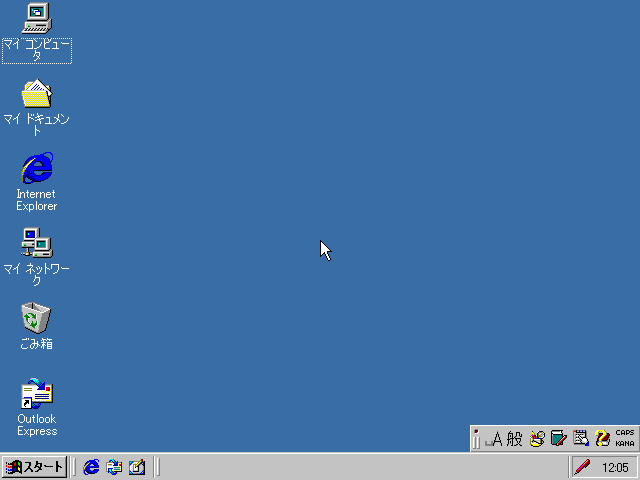 |

Every guest below with media in the lab is booted and checked by
`test/tools/guests_check.sh` ([development.md](docs/development.md)).

| Guest | Status |
|---|---|
| OpenVMS 8.4 | Installs from its CD and boots to login on every emulated machine, with up to sixteen CPUs; DECwindows on the Permedia 2 and the Radeon 7500 ([notes](docs/openvms.md), [installation guide](https://github.com/lenticularis39/axpbox/wiki/OpenVMS-installation-guide)) |
| Windows NT / 2000 | Installs and runs through AlphaBIOS, on up to two CPUs, with each graphics card's own driver from the installation media ([installation guide](https://web.archive.org/web/20260705122517/https://www.zx.net.nz/computers/dec/axpemu-es40.shtml)) |
| Windows "Whistler" 64-bit (AXP64, build 2210) | Installs and runs through AlphaBIOS, on up to two CPUs |
| Linux | Gentoo's install CD boots to a shell, and a system installed from it boots from disk to a login on one or two CPUs, where gcc works; serial or VGA console ([notes](docs/linux.md)) |
| Tru64 UNIX | Boots |
| NetBSD | Boots; the 10.2 install CD boots to its installer ([installation guide](https://github.com/lenticularis39/axpbox/wiki/NetBSD-9.2-install-guide)) |

## Emulated hardware

| Area | Devices |
|---|---|
| Machines | AlphaServer ES40, DS20E, DS20, DS20L, DS10 (Tsunami); ES45, DS25, DS15 (Titan); ES47, ES80, GS1280 (EV7, "Marvel") |
| CPU | EV68CB (21264), 1–4; EV7 and EV7z (21364), 2–16; the cancelled EV8 (21464), in an EV7-compatible mode, 2–16 |
| Storage | Symbios 53C8xx and QLogic ISP SCSI; ALi and CMD 649 IDE; floppy; virtio-blk |
| Graphics | S3 Trio64; Cirrus GD5430/5434; ATI Mach64 through the 3D Rage Pro; 3Dlabs Permedia 2; S3 ViRGE family; DEC TGA and TGA2; ATI Radeon 7500 |
| Network | DEC Tulip 2104x/2114x; Intel 8255x (DE600, DE602); virtio-net |
| USB | OHCI and EHCI controllers; tablet, keyboard, disks, speaker, host passthrough |
| Other | Ensoniq ES1370/ES1371 sound; DEC PCI-PCI bridges; serial ports, keyboard, mouse |

The full list, chip by chip, is in [docs/hardware.md](docs/hardware.md);
what is not emulated, and where a model is known to differ from the real
part, in [docs/limitations.md](docs/limitations.md).

## Quick start

```
git clone --recurse-submodules https://github.com/artur/alphabox
cd alphabox
cmake -S . -B build
cmake --build build -j
./build/alphabox configure    # writes es40.cfg
./build/alphabox run
```

You also need an SRM console ROM image, and a VGA BIOS for the graphics
card. Optional build dependencies
(libpcap, libusb, and libslirp for the built-in NAT network, which needs no
privileges) are listed in [building](docs/building.md). libslirp and libpcap
are also optional at run time: the binary starts without them, and a NIC
that uses `type = "nat"` or the pcap back end loads its library then (on
Linux `apt install libslirp0` or `libpcap0.8`; on macOS `brew install
libslirp`, and macOS ships libpcap). The [documentation](docs/README.md) covers the rest:
[building](docs/building.md), [running and configuring](docs/configuration.md),
[the machines](docs/platforms.md), [USB](docs/usb.md),
[headless operation](docs/headless.md) and
[development and testing](docs/development.md).

## History and license

Alphabox began as **es40**, by **Camiel Vanderhoeven** and the ES40 Emulator
Project, revived as [AXPbox](https://github.com/lenticularis39/axpbox) by
**Tomáš Glozar** and **Remy van Elst**. Much of its CPU core, the x86-64
JIT and several devices were written by **gdwnldsKSC** and the contributors
of [ES40-Emu](https://github.com/ES40-Emu/es40), and ported in 2026. This
repository continued AXPbox as its own project, adding the AArch64 JIT,
the machines beyond the ES40, USB and most of the device families, and was
renamed Alphabox in 2026. It builds on MAME, Bochs, QEMU, 86Box, Mesa and
others: [docs/acknowledgements.md](docs/acknowledgements.md).

GNU General Public License, version 2 or later: see [LICENSE](LICENSE).
Third-party code keeps its original license, as noted in the source file
headers and listed in [docs/acknowledgements.md](docs/acknowledgements.md).
